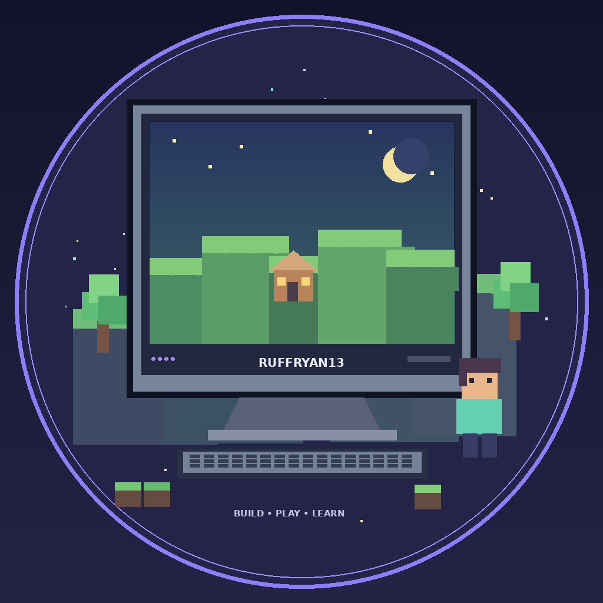

# Ruffryan13 Projects

A playful, responsive personal launchpad for learning, games, and everyday tools.



## Run locally

Open `index.html` in a browser, or serve this folder with Python:

```sh
python3 -m http.server 8000
```

Then open `http://localhost:8000`.

## What's in this preview

- Search and filter the app cards by category.
- Switch between dark and light themes.
- Save a quick note in this browser only.
- Preview a sample lesson or note outline for a topic.
- View the custom square, circle-safe `ruffryan13-world.png` illustration.
- See which ideas need an account, provider, or desktop integration before they can work.

The AI lesson and notes tools are previews, not connected AI services. Email, Google Calendar, OpenBot, cloud, remote desktop, and account features are not connected. Browser Games is waiting for the game list. No passwords or external account data are collected by this static preview.
